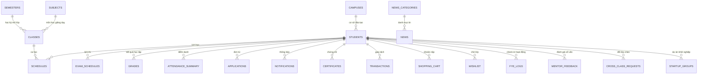

# CAP - CTL University Academic Portal (Full-Stack Web Portal)

Dự án mô phỏng và tái tạo (reverse engineering & full-stack clone) toàn diện 100% hệ thống **CAP - CTL University Academic Portal** (Đại học CTL - CTL Education), bao gồm đầy đủ dữ liệu frontend, backend Node.js (Express), cơ sở dữ liệu SQLite (`cap.db`), cùng toàn bộ 27+ phân hệ chức năng đào tạo, tài chính, học vụ và sinh viên.

---

## 1. Bản sắc Thương hiệu & Hệ màu Chủ đạo (CTL University Theme)

Hệ thống được chuyển đổi sang bộ nhận diện thương hiệu học thuật hiện đại **CTL Cyber Sapphire & Aurora Cyan**:

* **Màu biểu trưng chính (Primary Accent)**:
  * **Xanh Sapphire / Cyber Indigo (`#4361ee`)**: Tượng trưng cho trí tuệ, chiều sâu học thuật và chuẩn mực quốc tế.
  * **Xanh Cực Quang / Aurora Cyan (`#00b4d8` / `#00d2ff`)**: Điểm nhấn năng động, công nghệ cao và tinh thần đổi mới sáng tạo.
* **Màu bề mặt & Nền tối (Dark Mode Surface)**:
  * **Nền tổng thể (`theme-color`, Body)**: `#0a0f1d` (Deep Midnight Slate).
  * **Nền thẻ Card & Sidebar**: `#111a2e` / `#0d1527` (Navy Sapphire sang trọng, tương phản cao).
* **Bảng màu trạng thái học vụ (Status Palette)**:
  * **Thành công (Đã điểm danh / Passed / Ví)**: `#06d6a0` (Aurora Green).
  * **Cảnh báo (Chưa diễn ra / Vắng 15-20%)**: `#ffb703` (Golden Amber).
  * **Nguy cơ / Cấm thi / Failed**: `#ef476f` (Vibrant Coral Rose).
* **Logo Vector chuẩn thương hiệu**:
  * `logo-ctlu.svg`: Khiên công nghệ và chữ ký **CTL UNIVERSITY - ACADEMIC PORTAL**.
  * `logo-ctl.svg`: Biểu tượng vuông bo góc (Squircle Icon) thu gọn cho thanh bên và mobile.

---

## 1. Kiến trúc hệ thống

```
f:\larp-cap\
├── server.js              # Server Backend Express & Định tuyến 27+ Routes
├── db.js                  # Cơ sở dữ liệu SQLite (node:sqlite) & Logic nghiệp vụ
├── cap.db                 # Database SQLite cục bộ (20+ bảng quan hệ)
├── index.html             # Trang chủ CAP Dashboard
├── views/
│   ├── layout.js          # Khung giao diện dùng chung (Topbar, Sidebar, Theme, Notification)
│   ├── timetable.js       # Phân hệ Thời khóa biểu tuần
│   ├── exam.js            # Phân hệ Lịch thi chuẩn 9 cột
│   ├── attendance.js      # Phân hệ Báo cáo điểm danh
│   ├── grade.js           # Phân hệ Báo cáo điểm & Bảng điểm tích lũy
│   ├── academics.js       # Khung chương trình, Môn học, Chứng chỉ, Xét OJT, Xét KLTN
│   ├── finance.js         # Học phí, Giỏ hàng, Phí xếp lớp, Lịch sử giao dịch, Nạp tiền ví
│   ├── services.js        # Wishlist, Đổi lớp chéo, Đơn khởi nghiệp, FYE Log, Mentor, Quy chế, HDSD
│   ├── news.js            # Tin tức & Thông báo
│   ├── account.js         # Hồ sơ cá nhân sinh viên
│   ├── student_profile.js # Form cập nhật hồ sơ
│   └── application.js     # Danh mục & Gửi đơn từ trực tuyến
├── assets/                # Giao diện vendor (Jidox, Bootstrap 5, RemixIcon, Flatpickr)
├── css/                   # Stylesheet tùy biến của CAP
├── js/                    # Các module nghiệp vụ frontend
└── scripts/               # JavaScript modules bóc tách qua REA
```

---

## 2. Thiết kế Cơ sở Dữ liệu Toàn diện (`cap.db`)

Hệ thống sở hữu cơ sở dữ liệu quan hệ gồm **20 bảng** bao quát toàn bộ quy trình vận hành của CTL Education:

### Sơ đồ Thực thể Quan hệ (ERD):



---

## 3. Danh mục 27+ Phân hệ & Chức năng đã hiện thực

### I. Học tập & Khảo thí
- `/WeeklyTimetable`: **Thời khóa biểu tuần** dạng lưới Slot 1..6 x Thứ 2..Chủ nhật.
- `/ExamSchedule`: **Lịch thi** chi tiết phòng thi, ca thi, ngày thi và hình thức thi (FE 1, FE 2, PE).
- `/Report/Attendance`: **Báo cáo điểm danh** trực quan kèm thanh tiến trình % vắng mặt (cảnh báo cấm thi nếu > 20%).
- `/Report/Grade`: **Báo cáo điểm** chi tiết từng đầu điểm (Chuyên cần, Quiz, Lab, Giữa kỳ, Cuối kỳ, TB môn).
- `/Report/Transcript`: **Bảng điểm tích lũy** toàn khóa học, quy đổi GPA hệ 10 và hệ 4.
- `/Report/OjtConditions`: Xét duyệt **điều kiện đi thực tập doanh nghiệp (OJT)**.
- `/Report/ThesisConditions`: Xét duyệt **điều kiện làm Khóa luận tốt nghiệp (KLTN / Capstone)**.
- `/Curriculum`: **Khung chương trình đào tạo** 9 kỳ của chuyên ngành An toàn thông tin.
- `/Subject`: Danh mục toàn bộ môn học trường Đại học CTL kèm số tín chỉ và bộ môn phụ trách.
- `/MyCertificates`: Quản lý chứng chỉ tích lũy (GDQP&AN, Vovinam, Tiếng Anh, Coursera).

### II. Tài chính & Học phí
- `/ShoppingCart`: **Giỏ hàng học phí** & các khoản phí xếp lớp, hỗ trợ **Thanh toán ngay bằng số dư ví**.
- `/Transaction`: **Lịch sử giao dịch** tài chính minh bạch (Mã giao dịch, số tiền, phương thức, trạng thái).
- `/Finance/Topup`: **Nạp tiền vào ví CAP** hỗ trợ mock VNPay VietQR, Ví MoMo, Thẻ ngân hàng.
- **Đa ngôn ngữ (i18n)**: Hỗ trợ chuyển đổi linh hoạt 100% giữa **Tiếng Việt** và **Tiếng Anh (English)** tại Topbar (`/Language/SetLanguage`).
- **Phiên bản hệ thống**: `1.0.0.0` (CAP System).

### III. Thủ tục & Đơn từ
- `/Application/Catalog`: **Danh mục toàn bộ thủ tục & biểu mẫu** hành chính sinh viên.
- `/Application`: Xem lịch sử đơn từ và **Gửi đơn trực tuyến mới** lưu trực tiếp vào database.
- `/CrossClassChange`: **Đơn xin đổi lớp chéo** giữa các lớp học phần.
- `/Wishlist`: **Đăng ký Wishlist** nguyện vọng mở lớp cải thiện hoặc học vượt.
- `/StartupGroup`: **Đăng ký dự án Khởi nghiệp** sinh viên tham gia vườn ươm CTL.

### IV. Hoạt động & Hỗ trợ sinh viên
- `/FyeCheckInLog`: **Nhật ký Check-in FYE** tích lũy điểm rèn luyện tại các sự kiện, hội thảo.
- `/FyeMentorFeedback`: **Đánh giá Cố vấn học tập (Mentor)** theo thang điểm 1 - 5 sao.
- `/Document`: Kho văn bản quy chế, sổ tay sinh viên và biểu mẫu hướng dẫn.

### V. Thông tin & Quản trị tài khoản
- `/News`: Danh mục **Tin tức & Thông báo** có bộ lọc theo Khảo thí, Đào tạo, Tài chính.
- `/News/Detail/:id`: Xem chi tiết nội dung bài viết thông báo.
- `/Account`: Xem tổng quan hồ sơ sinh viên, số dư ví, chuyên ngành.
- `/StudentProfile`: **Cập nhật thông tin hồ sơ** (số điện thoại, địa chỉ, ngày sinh, giới tính).
- `/Notification/*`: Bộ API thông báo chuông (UnreadCount, BellList, MarkRead, MarkReadAll).
- `/Auth/Login`: Cổng đăng nhập CAP chuẩn giao diện CTL (hỗ trợ Google OAuth mock, mật khẩu, và đăng nhập nhanh 1-click).
- `/Auth/Logout`: Đăng xuất 100% chuẩn quy trình (xóa cookie phiên và chuyển hướng an toàn).
- `/Auth/SwitchUser/:roll`: Chuyển đổi nhanh tài khoản trực tiếp ngay trên thanh Topbar.

---

## 4. Dữ liệu Đa Học Kỳ (Multi-Semester Database)

Hệ thống cơ sở dữ liệu `cap.db` đã được nạp dữ liệu đầy đủ qua **7 học kỳ**:
1. **Spring 2025** (Kỳ 1): PRF192, MAE101, CSI104, VOV114.
2. **Summer 2025** (Kỳ 2): PRO192, MAD101, OSG202, VOV124.
3. **Fall 2025** (Kỳ 3): CSD201, DBI202, NWC203, VOV134.
4. **Spring 2026** (Kỳ 4): PRN211, MAS291, SWE201, IAE301.
5. **Summer 2026**: Kì chuyển tiếp / thực tập định hướng.
6. **Fall 2026** (Kỳ 5 - Hiện tại): KRG301, KOR411, VOV114, IAE301, SWP391.
7. **Spring 2027**: Học kỳ dự kiến.

Tất cả các trang **Thời khóa biểu**, **Lịch thi**, **Điểm danh**, và **Báo cáo điểm** đều có dropdown học kỳ hoạt động 100% (`?semester=...`), tự động truy vấn dữ liệu quá khứ tương ứng từ SQLite và tính toán GPA tích lũy động.

---

## 5. Tài khoản Thử nghiệm (Test Accounts)

| Mã tài khoản | Họ và tên | Chuyên ngành / Vai trò | Mật khẩu |
|---|---|---|---|
| `CT193667` | **Cao Thanh Lâm** | K19 - An toàn thông tin (BIT_IA) | `123456` |
| `SE180123` | **Trần Hoàng Long** | K18 - Kỹ thuật phần mềm (BIT_SE) | `123456` |
| `GV001` | **ThS. Hoàng Quốc Khánh** | Giảng viên CNTT | `123456` |

---

## 6. Hướng dẫn khởi chạy

```bash
# Khởi chạy server CAP
npm start
# hoặc: node server.js
```

Truy cập trình duyệt: **`http://localhost:3000/`** (Tự động chuyển hướng tới `/Auth/Login` nếu chưa đăng nhập).

Kiểm thử tự động:
```bash
node test_auth_and_semesters.js  # 18/18 test case Đăng nhập & Đa học kỳ đạt 100%
node audit_links.js               # 41/41 routes liên kết nội bộ đạt 100%
```
